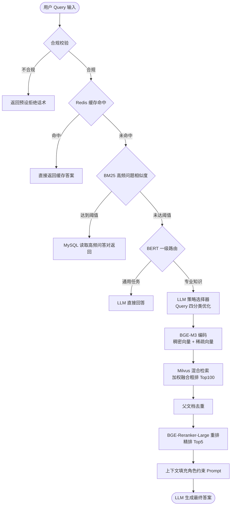

基于langchain框架做的redis缓存命中+向量数据库milvus+知识库挂载，由二级路由分类+4个query检索+统一生成的方式实现的，
整个流程是用户query进来后，先做合规校验，不满足合规的，调用预先设置好的拒绝话术，合规的就走redis缓存命中，未命中的用bm25检索我们设置的阈值，满足就去sql检索，
不满足就调用rag系统，这里sql和redis存放的是我们人工统计的一个高频问答对，缓解rag系统压力，当用户query不满足bm25检索的阈值，会调起rag系统，这里先
有bert实现的一级路由，在做二分类任务，这是提前训练好用来判断用户输入的是通用任务还是公司内部的专业知识，如果预测是通用任务，直接调用llm回答，如果是专业
知识，就走我们的4个query检索，这四个任务检索是用prompt+llm实现的策略选择器，我们先设置一个prompt，规定每种分类的要求并给出例子，让模型自己去把query分类，我
设置了四种分类，子问题查询，回溯问题，直接查询，假设问题检索，每一种分类我们都预设了prompt模板，比如是回溯问题，我们模板会让llm把这个问题简化，如果是
子问题查询，我们会让llm分为多个子任务，每行一个查询，这里目的是为了对用户输入的prompt进行优化，降低后面llm的幻觉，然后把优化后的prompt用bgem3模型
生成稀疏向量和稠密向量，去milvus数据库中检索，返回加权处理的topk，top一般设置为50--100，这里我对这个粗排结果设置了100，然后对返回的topk转化为document，
要对他做一个父文档去重，然后用bge reranker large进行重排，返回精排topk，这里我设置了5，这下我们就拿到最终的上下文了，我们再用prompt模板，把上下文
填充进去，用这个模板发给llm，让他给出最终返回给用户的答案。这里prompt就是给llm设置一个角色，比如你是公司资深的只能客服，你的回答必须基于给你的上下文，
你生成的答案要准确，避免无关信息等，这里的向量数据库是用一些pdf、md、ppt、docx文档通过langchain框架的BaseLoader，ocr识别用的rapidocr_paddle的
RapidOCR实现的，我自己在外层又加了一些解释器的方法，文件底层是不一样的，比如pdf的图像数据在xref里面，ppt的图像、表格，在底层就写死了，比如图片是13，
word用xpath去匹配，他是流式文档，处理起来非常方便，我们加载word就可以直接遍历底层的xml w:tbl w:p实现，ppt虽然底层也是xml但他本质是版式文档，底层的
xml是用户自己创建的，不能像word那样直接遍历，需要一些算法去重排它
# Agentic RAG 智能客服问答系统

基于 LangChain 构建的 Agentic RAG 知识问答系统，采用「Redis 缓存命中 + Milvus 向量检索 + 知识库挂载」架构，通过「二级路由分类 + 4 种 Query 检索策略 + 统一生成」的方式，实现从合规校验、缓存加速、意图路由到混合检索与约束生成的全链路闭环。

## 特性

- **双通道加速**：Redis 语义缓存 + 人工统计高频问答对（BM25 匹配），高频问题毫秒级响应，显著缓解 RAG 系统压力
- **二级路由**：BERT 意图分类（通用任务 / 专业知识）+ LLM 策略选择器（4 种 Query 优化），按需调度，控制 Token 成本
- **混合检索**：BGE-M3 稠密 + 稀疏双路向量，Milvus 粗排 Top100 → 父文档去重 → BGE-Reranker-Large 精排 Top5
- **自研文档解析引擎**：支持 PDF / Word / PPT / Markdown，按底层结构差异化处理，配合 RapidOCR 识别图中文字
- **量化评估**：基于 RAGAS 框架完成全流程评测（见[评估结果](#评估结果)）

## 核心流程



## 流程详解

### 1. 合规校验

用户 Query 进入系统后先做合规校验，不合规的请求直接返回预设的拒绝话术，不进入后续链路。

### 2. Redis 缓存与高频问答匹配

合规 Query 优先查询 Redis 缓存，命中则直接返回。未命中时，用 BM25 + Softmax 计算 Query 与人工统计高频问答对的相似度，达到阈值即判定为同一问题，直接从 MySQL 读取答案返回。

> 高频问答对由人工统计维护，同时存放于 Redis 与 MySQL，用于承接高频流量、缓解 RAG 系统压力。

### 3. BERT 一级路由

相似度未达阈值的 Query 进入 BERT 一级路由，做二分类任务（提前训练好），判断用户输入是**通用任务**还是**公司内部专业知识**：

- **通用任务** → 直接调用 LLM 回答
- **专业知识** → 进入 4 种 Query 检索策略

### 4. LLM 策略选择器（4 种 Query 优化）

策略选择器由 Prompt + LLM 实现：预先在 Prompt 中规定每种分类的要求并给出示例，让模型自行将 Query 分类，每一种分类对应预设的 Prompt 模板。目的是对用户输入的 Query 进行优化，降低后续生成的幻觉。

| 策略类型     | 处理方式                                                   |
| ------------ | ---------------------------------------------------------- |
| 直接查询     | 语义完整明确，不做改写，直接用原 Query 检索                |
| 子问题查询   | LLM 将复杂问题拆分为多个子任务，每行一个查询，分别检索     |
| 回溯问题     | 多轮对话中的指代/追问，模板让 LLM 结合上下文将问题简化改写 |
| 假设问题检索 | LLM 先生成假设性答案，再以假设答案进行检索（HyDE 思路）    |

### 5. 混合检索与重排

1. 优化后的 Query 用 BGE-M3 编码为**稠密向量 + 稀疏向量**
2. 在 Milvus 中混合检索，对结果做加权融合，返回粗排 TopK（本项目设为 **100**）
3. 粗排结果转化为 Document，并做**父文档去重**
4. 用 BGE-Reranker-Large 重排序，返回精排 TopK（本项目设为 **5**），作为最终上下文

### 6. 约束生成

将精排上下文填充进角色约束 Prompt 模板（如：「你是公司资深的智能客服，回答必须基于提供的上下文，答案要准确，避免无关信息」），发送给 LLM 生成最终答案，保证回答的忠实度。

## 关键参数配置

| 参数               | 取值 | 说明                                                         |
| ------------------ | ---- | ------------------------------------------------------------ |
| 高频问题相似度阈值 | 0.90 | BM25 + Softmax 相似度达到该值即判定同一问题，直接走 SQL 返回 |
| 粗排 TopK          | 100  | Milvus 混合检索加权融合返回数量                              |
| 精排 TopK          | 5    | BGE-Reranker-Large 重排后的最终上下文数量                    |

## 文档解析引擎

文档加载器继承 LangChain 的 `BaseLoader` 实现，支持 PDF / Word / PPT / Markdown；图片中的文字识别使用 `rapidocr-paddle` 的 RapidOCR。在每种格式外层封装了解释器方法，针对不同格式的底层结构差异做差异化处理：

| 格式         | 底层特点                                  | 处理方式                                                     |
| ------------ | ----------------------------------------- | ------------------------------------------------------------ |
| PDF          | 图像数据存放在 xref 表中                  | 解析 xref 表提取图像数据，配合 OCR 识别文字                  |
| Word (.docx) | 流式文档，底层 XML 结构规整               | 直接遍历底层 XML 的 `w:tbl`（表格）、`w:p`（段落），用 xpath 匹配元素，处理非常方便 |
| PPT (.pptx)  | 版式文档，底层 XML 由用户创建、顺序不规则 | 不能像 Word 一样直接遍历，自研重排算法还原内容顺序；图片、表格在底层有固定标识（如图片类型标识为 13），可直接定位 |
| Markdown     | 纯文本标记语言                            | LangChain 原生方式加载                                       |

## 技术栈

| 模块         | 技术选型                                        |
| ------------ | ----------------------------------------------- |
| 应用框架     | LangChain                                       |
| 大模型       | 千问大模型                                      |
| 向量数据库   | Milvus（稠密向量 IVF_FLAT 索引 + 稀疏倒排索引） |
| Embedding    | BGE-M3（稠密 + 稀疏双向量编码）                 |
| 重排模型     | BGE-Reranker-Large                              |
| 意图路由     | BERT（通用任务 / 专业知识二分类）               |
| 高频匹配     | BM25 + Softmax（阈值 0.90）                     |
| 缓存         | Redis 7.0（语义缓存）                           |
| 高频问答存储 | MySQL                                           |
| 文档解析     | 自定义 BaseLoader + RapidOCR（rapidocr-paddle） |
| 检索改写     | HyDE                                            |

## 快速开始

```bash
git clone https://github.com/yhdwzwl/agentic-rag-qa-system.git
cd agentic-rag-qa-system
pip install -r requirements.txt

# 配置千问 API Key、Milvus / Redis / MySQL 连接信息（见 config 文件）
python main.py  # TODO: 替换为实际入口文件
```

> 说明：依赖清单与启动命令请按项目实际情况补全。

## 评估结果

使用 RAGAS 框架对全流程进行量化评测：

| 指标                              | 得分 |
| --------------------------------- | ---- |
| 忠实度（Faithfulness）            | 92%  |
| 答案相关性（Answer Relevance）    | 90%  |
| 上下文相关性（Context Relevance） | 79%  |
| 上下文召回率（Context Recall）    | 83%  |
